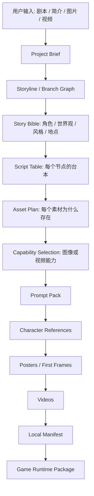

# 通用互动媒体素材流水线

这个文档定义第一版通用工具的工作边界：在它成为一个游戏之前，先把剧本、台本、角色、场景、生成能力选择和本地素材清单整理完整。

项目内 skill 位于：

- `interactive_video_game/skills/interactive-media-asset-pipeline/SKILL.md`

## 第一版范围

本版只做文档和 schema，不接真实视频 submit/poll/download adapter，不新增 style A/B 和 contact sheet 能力。

已覆盖：

- GPT Image 2-C 的模型原生图像能力总结
- Ark Seedance 的模型原生视频能力总结
- Ark submit/poll/download adapter 的接口设计
- Planning / Executive / Checker 三 agent 协作协议
- 通用工作流
- 项目 brief schema
- story bible schema
- script table schema
- asset plan schema
- generation manifest schema
- 归档总结

暂不覆盖：

- 自动批量提交视频任务
- 自动轮询和下载视频
- 自动 A/B 风格测试
- 自动 contact sheet
- 自动拼接最终 HTML/Godot 游戏

## 标准链路



## Multi-Agent 协作结构

这条链路默认不是单 agent 完成，至少分成三个角色：

- Planning Agent：当前 Codex。负责理解需求、规划 storyline、定义角色和风格、写 schema 化台本、做资产计划、决定哪些能力被调用，并把任务拆给执行和检查。
- Executive Agent：Claude Code 1。负责读取 Planning 产物，按批准范围扩写 prompt、提交生成任务、保存本地文件、写 generation manifest。它不允许重写剧情结构，也不允许新增 runtime 没有引用的素材。
- Checker Agent：Claude Code 2。负责独立读取 brief、script、asset plan、manifest 和本地素材，检查 schema、路径、runtime 引用、风格一致性、角色一致性、第一视角规则和安全规则。它不直接修产物，只输出通过或重跑清单。

交接顺序固定：

1. Planning 先完成 project brief、story bible、script table、asset plan。
2. 用户确认或修改计划。
3. Executive 执行已批准的素材/manifest 工作。
4. Checker 独立验收。
5. Planning 根据 Checker 报告决定通过、定点重跑，或回到计划层调整。

## 关键原则

先规划整体 storyline，再扩写每个节点的具体内容。互动视频最怕先写局部桥段，最后发现分支断了、时长不对、失败结局不可达。

素材生成只服务 runtime。每个资产都必须能回答：

- 在游戏哪里展示或播放？
- 哪个字段引用它？
- 如果不生成，游戏链路会不会断？

角色一致性靠顺序和引用控制：

1. 先定角色简介和视觉锚点。
2. 再生成角色主参考图。
3. 节点 poster 只输入该节点实际出场角色的参考图。
4. 视频从批准后的 poster / first frame 开始。

风格一致性靠 style profile，而不是每个 prompt 临时发挥。参考图不能被当成纯 style，它也会把主体带进结果。

## Schema 文件

- `interactive_video_game/schemas/media_project_brief.schema.json`
- `interactive_video_game/schemas/media_story_bible.schema.json`
- `interactive_video_game/schemas/media_script.schema.json`
- `interactive_video_game/schemas/media_asset_plan.schema.json`
- `interactive_video_game/schemas/media_generation_manifest.schema.json`

`media_generation_manifest` 现在必须记录：

- `pipeline_run_id`
- Planning / Executive / Checker / human agent provenance
- source artifacts
- 顶层 acceptance 状态
- 每个素材的 review 状态、lineage、runtime references 和 policy checks

未经过 Checker review 的 runtime 素材不得进入最终游戏配置。

## 推荐产物目录

```text
interactive_video_game/
  outputs/<game_id>/
    project_brief.json
    story_bible.json
    script_table.json
    asset_plan.json
    generation_manifest.json
    prompt_pack/
    rerolls/
  video_engine/public/assets/<game_id>/
    characters/
    locations/
    posters/
    videos/
    tail_frames/
```

## 给 Claude Code 的第一轮任务边界

第一轮可以启动两个 Claude Code，但角色必须分开。

Executive Agent 第一轮只让它扩写和准备，不让它直接花钱生成：

- 读取 project brief。
- 设计 storyline 和节点图。
- 写 story bible。
- 写 script table。
- 写 asset plan。
- 标明每个资产使用的模型能力。
- 标明哪些素材真正进入 runtime。
- 输出待审批清单。

Checker Agent 第一轮只做检查：

- 检查 storyline 是否连通。
- 检查每个资产是否有 runtime 字段承接。
- 检查 schema 字段是否完整。
- 检查是否有多角色参考图污染单节点 poster 的风险。
- 输出 blocking issues 和 rerun / revision 建议。

审批后再进入素材生成阶段。
