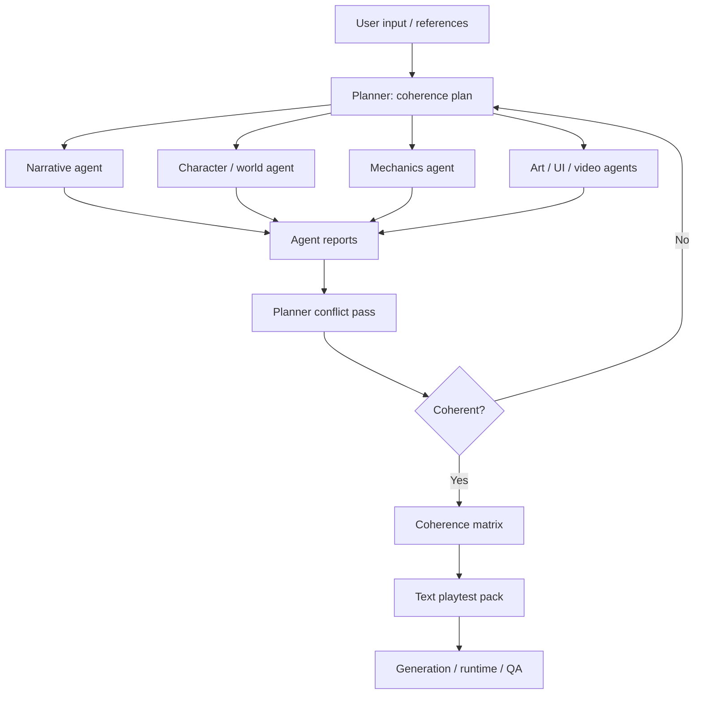

# Architecture

`media_asset_pipeline` is a pre-runtime production layer. It converts loose creative input into a coherent, reviewable, generatable, and runtime-ready game content package.

This version is Planner-first, not script-first. Story planning is important, but the script is one discipline among several. The Planner owns the cross-disciplinary control plane and resolves conflicts between narrative, art, mechanics, video, UI, runtime, budget, and player comprehension.

## Control Plane



## Canonical Artifacts

1. `coherence_plan.json`
   Planner-owned project control file. It defines player promise, disciplines, constraints, budgets, hard rules, open risks, and conflict-resolution policy.

2. `story_plan.json`
   Planner-owned narrative structure. It defines route graph, story cells, duration budgets, comprehension gates, and approved content scope.

3. `character_design.json`
   Character/world constraints. It defines visible characters, relationship arcs, visual anchors, speech style, knowledge boundaries, and portrait/expression requirements.

4. `hybrid_script.json`
   Narrative agent output. It expands each story cell into runtime beats: narration, dialogue, phone messages, hints, memory unlocks, character layers, video playback, and choices.

5. `asset_plan.json`
   Art/video/UI production contract. It contains only assets that are approved by the Planner and referenced by runtime or QA.

6. `coherence_matrix.json`
   Cross-domain traceability table. Every row maps a story cell or choice to required story facts, visual evidence, UI surfaces, mechanics, assets, runtime fields, and acceptance checks.

7. `agent_report.json`
   Standardized worker/checker report. Every agent must declare assumptions, changes, conflicts, missing dependencies, and questions for Planner.

8. `text_playtest_pack.json`
   A MUD-like playable projection of the plan. It uses text, state, choices, lock hints, and asset slot names to test the whole route before media generation.

## Gate Flow

```text
G0 Intake
  Normalize user input, references, constraints, target duration, style, and output format.

G1 Coherence Plan
  Planner defines the game promise, agent scopes, budgets, hard constraints, and conflict-resolution policy.

G2 World / Character / Mechanics Baseline
  Character/world/mechanics agents propose constraints and risks before detailed writing begins.

G3 Story Plan
  Planner creates route graph and story-cell budgets. This is not final prose; it is the control map.

G4 Narrative Expansion
  Narrative agent writes concrete cells under Planner constraints.

G5 Art / UI / Video Support Plans
  Art, UI, and video agents map narrative needs to actual surfaces and assets.

G6 Coherence Matrix
  Planner or coherence auditor joins all domains into one traceability table.

G7 Planner Conflict Pass
  Planner resolves gaps: missing evidence, unrenderable scenes, unclear choices, cost overrun, UI overload, or unsupported runtime fields.

G7.5 Text Playtest
  Planner or Runtime compiles a text playtest pack. Checker verifies reachability, choice gating, state changes, comprehension before choice, and ending/failure traversal.

G8 Prompt Packs / Provider Payloads
  Generation executive prepares provider-ready prompts and payloads only for approved assets.

G9 Generation
  Generate characters first, then reusable poses/expressions, then backgrounds/stills/first frames, then video.

G10 Runtime Assembly
  Runtime agent compiles script and manifests into HTML or Godot without changing approved story beats.

G11 Coherence QA + Playtest
  Checker verifies player comprehension, asset-story traceability, runtime references, style consistency, and playable flow.
```

## Conflict Policy

Agents should not silently solve cross-discipline conflicts by changing another discipline's work.

Examples:

- Narrative wants a new prop. Art reports it needs a new generated asset. Planner either approves a new asset slot or rewrites the beat.
- Mechanics wants an early choice. Narrative reports the player does not understand the stakes yet. Planner delays the choice or adds a setup cell.
- Video wants a group scene. Art reports character consistency risk. Planner changes it to layered portraits plus text, or approves a controlled group still.
- UI wants a phone overlay. Runtime reports it hides the character layer on mobile. Planner reduces overlay density or changes the surface.

The Planner is allowed to revise the plan after reports. That is the intended loop.
