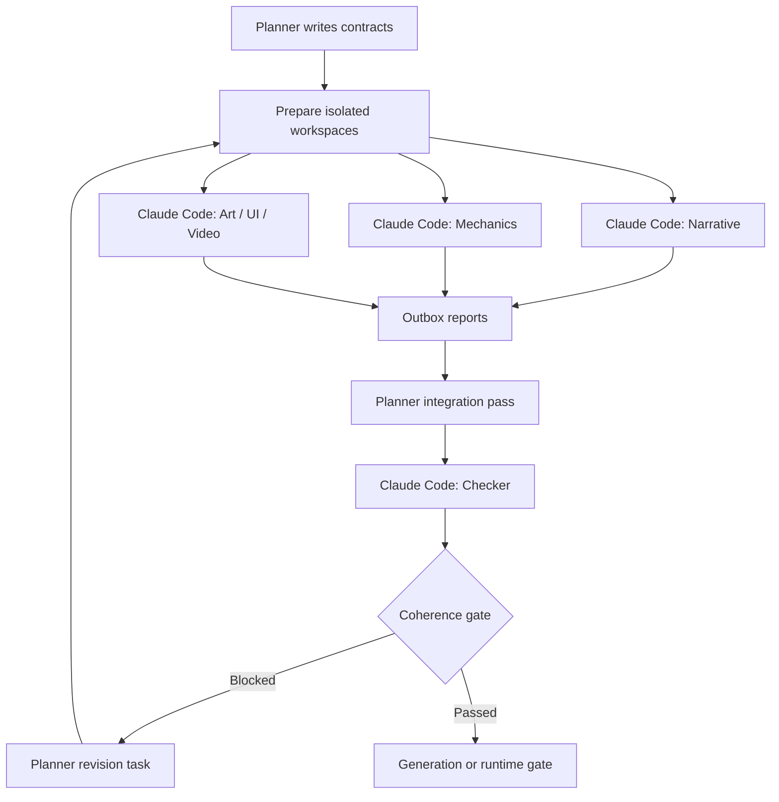

# Claude Code Isolated Agents

This document defines the execution pattern for real multi-agent runs. The
Planner remains in the current Codex thread, but worker/checker roles run as
separate Claude Code processes in isolated workspaces.

## Why This Exists

The earlier `spawn_agent` run was useful for proving the role split, but it was
not hard isolation. The agents inherited the current conversation and followed
file-ownership rules by prompt discipline.

For production-style coherence checks, each agent must instead receive a copied
handoff bundle, work only in its own workspace, and return an outbox report.
Planner then integrates approved outputs into canonical project files.

## Workspace Contract

Each agent gets this directory shape:

```text
runs/<run_id>/agents/<role>/
  workspace/
    inbox/      # copied handoff docs and read-only context
    outbox/     # the only place the agent may write deliverables
    scratch/    # temporary notes, discarded unless referenced
    logs/       # stdout/stderr from the Claude Code process
```

Rules:

- `inbox/` is a copied snapshot, not the live project tree.
- `outbox/` is the agent's only deliverable surface.
- Agents do not edit canonical project files.
- Checker receives copied outputs from all agents, not write access to their
  workspaces.
- Planner copies or rewrites approved outputs after reading every report.

## Claude Code Invocation

Use non-interactive Claude Code:

```bash
claude \
  --bare \
  --print \
  --no-session-persistence \
  --permission-mode bypassPermissions \
  --tools Bash,Read,LS \
  --model claude-sonnet-4-6 \
  --append-system-prompt "$(cat ROLE_CONTRACT.md)" \
  "$(cat TASK.md)"
```

Notes:

- `--bare` avoids accidental project memory, hooks, plugin sync, and local
  discovery.
- No `--add-dir` should be used for worker agents. The workspace is the whole
  world they see.
- Claude Code bare mode did not expose a reliable dedicated file-writing tool in
  this environment. The default launcher therefore allows Bash, but the process
  runs inside an isolated workspace and the role contract restricts writes to
  `./outbox` and `./scratch`.
- Use `--attempts`, `--timeout-sec`, and `--hard-timeout-sec` in the launcher.
  `--timeout-sec` is an idle timeout: the process may run longer if stdout,
  stderr, `outbox/`, or `scratch/` keeps changing. A process returning zero is
  not enough; expected outbox files must exist and be non-empty.

## Prompt Layers

Use two layers:

1. `ROLE_CONTRACT.md` via `--append-system-prompt`.
   This is the durable role contract: scope, ownership, forbidden edits,
   reporting format, and conflict-reporting policy.
2. `TASK.md` as the user prompt.
   This points to copied inbox files and names the required outbox files.

This is stronger than a chat-style instruction because every agent process gets
a clean context, a role contract, and a bounded filesystem view.

## Retry Policy

Use `bin/run_claude_agent.py` instead of calling `claude` directly.

Recommended defaults:

```bash
python bin/run_claude_agent.py \
  --run-dir runs/<run_id> \
  --role narrative \
  --agent-id narrative \
  --handoff planner/HANDOFF_NARRATIVE.md \
  --context planner/PLANNER_BRIEF.md \
  --expect hybrid_script.json \
  --expect narrative_agent_report.json \
  --model claude-sonnet-4-6 \
  --attempts 2 \
  --timeout-sec 900 \
  --hard-timeout-sec 7200
```

The launcher retries when:

- Claude exits with a non-zero status;
- Claude makes no observable progress for `--timeout-sec` seconds;
- Claude exceeds the wall-clock safety cap set by `--hard-timeout-sec`;
- expected files are missing;
- expected files are empty.

Each attempt writes separate logs:

```text
logs/attempt_1_stdout.txt
logs/attempt_1_stderr.txt
logs/attempt_1_progress.jsonl
logs/attempt_2_stdout.txt
logs/attempt_2_stderr.txt
logs/attempt_2_progress.jsonl
logs/attempt_summary.json
```

Observable progress means one of:

- stdout or stderr emits a line;
- a file under `outbox/` changes;
- a file under `scratch/` changes, usually `scratch/progress.md`.

If an agent repeatedly stalls on a large JSON task, Planner should split the
task by act, route, or asset category rather than increasing timeout forever.

## Planner Loop



## Required Agent Report

Every agent outbox must include:

- produced files;
- assumptions;
- unresolved dependencies;
- cross-discipline conflicts;
- requested Planner decisions;
- generation/runtime risks;
- recommended next gate.

Checker must also include:

- blocker/major/minor findings;
- affected story cells and choices;
- affected assets/UI/mechanics/runtime fields;
- whether the text-only CLI playthrough can reach all endings and failures.

## Text-Only Playtest Gate

Before image or video generation, Planner should build a `text_playtest_pack`.
The CLI playtest verifies:

- graph reachability;
- choice availability and lock hints;
- state changes;
- comprehension before choices;
- ending/failure traversal;
- whether every visual fact has a text/UI fallback.

This does not replace visual QA. It catches story-system breaks while iteration
is still cheap.
