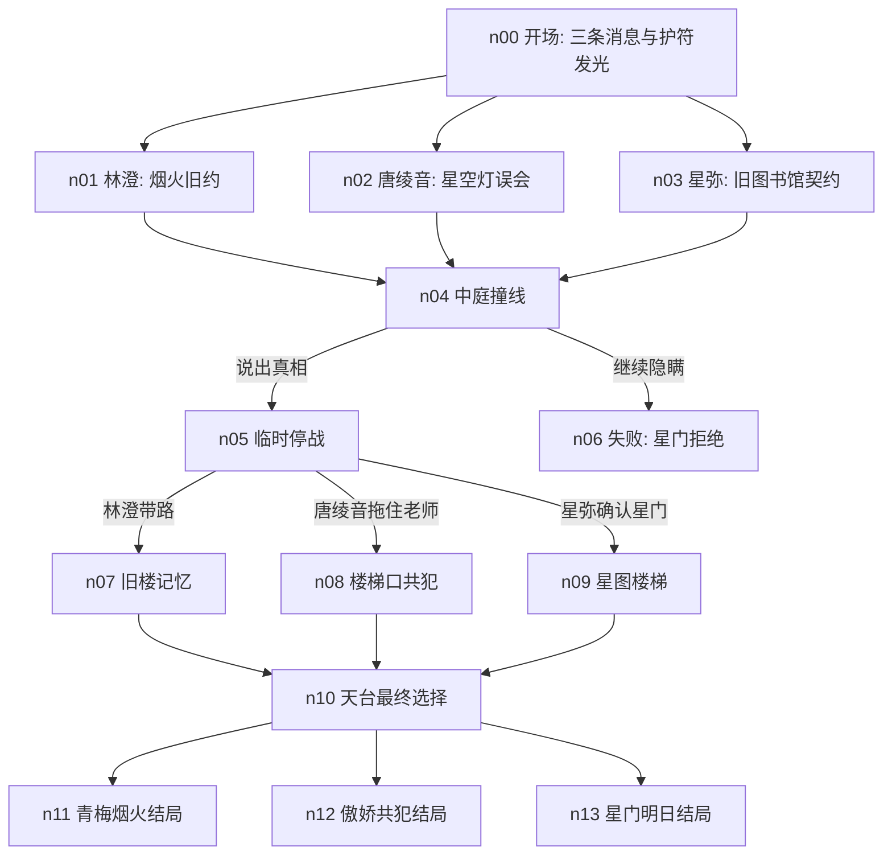

# Planning Report: 放学后的星门告白

## 目标

这是一次不跑素材的 Planning 试跑，用来验证 `media_asset_pipeline` 的三 agent 流程能不能从用户一句需求产出完整的游戏前置规划。

- 类型：第一视角互动视频游戏。
- 时长：典型通关路径约 74 秒，失败路径约 42 秒。
- 节点：14 个，包括 1 个开场、8 个剧情/选择/桥接节点、1 个中途失败、3 个结局。
- 题材：大学校园三角恋 / 轻奇幻。
- 主角：男生第一视角，不出镜。
- 素材：本轮只规划，不生成图像或视频。

## 核心设定

校园祭前夜，男主口袋里的星形护符在放学后发光。护符原本来自青梅竹马林澄的旧约，也和隔壁班唐绫音损坏的星空舞台灯产生共鸣，还召来了异界星图书库的从者星弥。

合理性处理：

- 林澄的诉求是“别再用沉默拖延承诺”。
- 唐绫音的诉求是“帮我澄清舞台事故，因为你知道我没撒谎”。
- 星弥的诉求是“帮助星门关闭，但她需要理解人的承诺”。

三个女生的目标都不是无理由争抢男主，而是被同一枚护符和同一场校园祭事件牵到一起。

## 角色

| 角色 | 定位 | 年龄 | 戏剧功能 |
| --- | --- | ---: | --- |
| 林澄 | 青梅竹马，同专业同班 | 20 | 情感旧约和普通日常线 |
| 唐绫音 | 隔壁公共课班傲娇女，戏剧社舞台负责人 | 20 | 误会澄清和行动派路线 |
| 星弥 | 异界星图书库从者，大学年龄外表 | 21 | 轻奇幻规则和承诺主题 |

## Story Graph

## 路径时长

| 路径 | 节点 | 约时长 |
| --- | --- | ---: |
| 常规任一路线 | n00 + n01/n02/n03 + n04 + n05 + n07/n08/n09 + n10 + ending | 74s |
| 中途失败 | n00 + n01/n02/n03 + n04 + n06 | 42s |

## 结局

- `n11_end_childhood`：青梅烟火结局。选择普通日常和旧约。
- `n12_end_tsundere`：傲娇共犯结局。选择站出来澄清误会。
- `n13_end_servant`：星门明日结局。选择帮星弥开门，同时留下明天会回到校园的现实承诺。

## 资产规划摘要

- 角色参考图：3 张。
- 节点 poster：14 张。
- 节点视频：14 段。
- 尾帧：只在视频生成返回时保存，不主动生成。
- UI 图 / 独立音频：本轮跳过，等 runtime 明确字段后再规划。

## 风险点

- `n04`、`n05`、`n06`、`n10` 是三人同屏，高风险，需要严格 Checker。
- 第一视角男主不出镜必须写入所有 poster/video prompt。
- 消息、契约页、工作牌等内容可以被画面暗示，不应依赖模型生成可读文字。
- 角色均设定为大学成年，避免校园题材产生年龄误解。

## 本轮交付

- `project_brief.json`
- `story_bible.json`
- `character_design.md`
- `character_design.json`
- `script_table.json`
- `asset_plan.json`
- `handoff/CHECKER_HANDOFF.md`
- `handoff/EXECUTIVE_HANDOFF.md`
